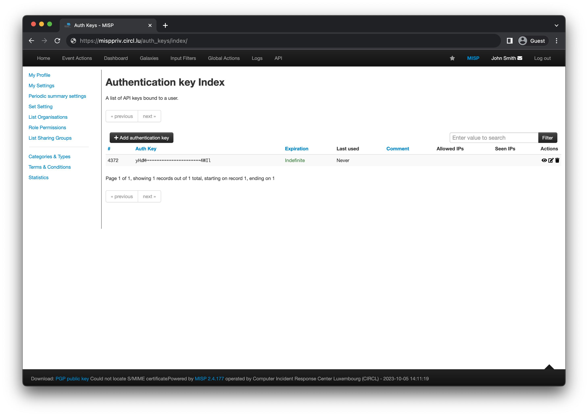
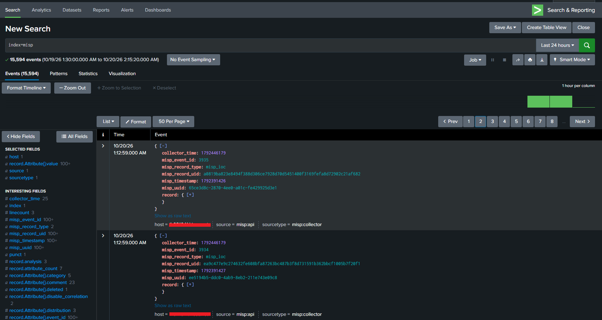
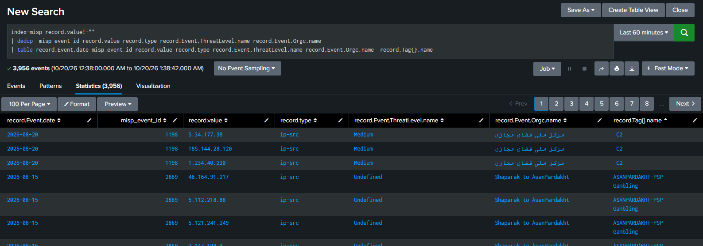

# Splunk MISP Threat Intelligence Collector

A scripted input for integrating [MISP](https://www.misp-project.org/) threat intelligence into Splunk.

The collector retrieves threat intelligence from the MISP REST API, converts the returned data into structured events, and makes it available for security monitoring, threat hunting, correlation searches, and dashboards in Splunk.

## Overview

MISP is an open-source threat intelligence platform used to collect, share, and correlate indicators of compromise (IOCs).

This project connects MISP to Splunk through a scripted input and supports collecting event and attribute data for centralized searching and analysis.

### Key Features

- MISP REST API integration using an authentication key.
- Collection of MISP events and attributes.
- Structured data suitable for Splunk searches and dashboards.
- Configurable API pagination and page size.
- Configurable request timeout.
- Configurable overlap window for incremental collection.
- Checkpoint-based collection state.
- Configurable TLS certificate verification.
- Support for sending collected events to a remote Splunk indexing tier.
- Example Splunk input and configuration files.

### Example Use Cases

- Search for IP addresses, domains, URLs, and other indicators shared through MISP.
- Investigate threat intelligence by event ID, organization, threat level, and tags.
- Build dashboards for IOC monitoring and threat hunting.
- Correlate MISP indicators with firewall, DNS, proxy, endpoint, and other security telemetry.
- Enrich security investigations with contextual threat intelligence.

## Architecture

The collector can run on a Splunk Search Head, Heavy Forwarder, or another appropriately configured Splunk instance.

### Option 1: Collector runs on the Heavy Forwarder

```text
MISP Platform
     |
     | HTTPS / REST API
     v
Splunk Heavy Forwarder
     |
     | Scripted Input
     v
MISP Collector
     |
     | Structured Events
     v
Splunk Indexer
     |
     v
Searches and Dashboards
```

When the collector runs on the Heavy Forwarder, and that instance is configured to index or forward the collected events to the intended indexing tier, a separate forwarding configuration is generally not required just for this collector.

Make sure the `misp` index exists on the appropriate indexing tier and that the input is configured to write to that index.

### Option 2: Collector runs on a separate Splunk instance

```text
MISP Platform
     |
     | HTTPS / REST API
     v
Splunk Search Head
     |
     | Scripted Input
     v
MISP Collector
     |
     | Splunk Forwarding
     v
Splunk Heavy Forwarder
     |
     v
Splunk Indexer
     |
     v
Searches and Dashboards
```

If the collector runs on a Search Head or another separate Splunk instance, configure Splunk forwarding to send the generated events to the intended receiving instance.

**Important:** Do not replace an existing `outputs.conf` configuration blindly. Integrate the required destination into the existing configuration and verify the effective configuration before restarting Splunk. A global forwarding change can affect other data sources, not just MISP.

## Requirements

- A reachable MISP instance.
- A valid MISP API authentication key with permission to read the required events and attributes.
- Splunk Enterprise or another Splunk deployment that supports the required scripted-input functionality.
- Network connectivity from the collector host to the MISP HTTPS endpoint.
- Python and the dependencies required by the collector script.
- A configured Splunk index named `misp`.
- A configured Splunk receiving and forwarding path if the collector does not send events directly to the intended indexing tier.

The Python version and required dependencies must be compatible with the target Splunk host and the installed collector script.

## Repository Structure

```text
misp_collector/
├── bin/
│   ├── misp_collector.py
│   └── misp_collector.sh
├── default/
│   └── props.conf
├── examples/
│   ├── inputs.conf.example
│   └── misp_collector.json.example
├── assets/
│   └── screenshots/
│       ├── misp-auth-key.png
│       ├── splunk-misp-search.png
│       └── splunk-misp-events.png
├── .gitignore
└── README.md
```

## Installation

### 1. Create a MISP API Authentication Key

The collector needs an authentication key to access the MISP REST API.

1. Sign in to your MISP instance with an account authorized to create or manage authentication keys.
2. Open the relevant user profile or authentication-key management page. Depending on your MISP version and permissions, this may be available through the user profile or the administration interface.
3. Create a new authentication key.
4. Assign only the permissions required to read the intended threat intelligence data.
5. Copy the key and store it securely.

The exact interface and available permission options may vary between MISP versions.

**Security recommendations:**

- Use a dedicated service account when possible.
- Apply least-privilege permissions.

#### Screenshot 1 — MISP API Authentication Key



### 2. Copy the Collector Files

Example:

```bash
sudo mkdir -p /opt/splunk/etc/apps/misp_collector

sudo cp -r bin default \
  /opt/splunk/etc/apps/misp_collector/
```

Create the required local configuration and runtime directories:

```bash
sudo mkdir -p \
  /opt/splunk/etc/apps/misp_collector/local \
  /opt/splunk/etc/apps/misp_collector/var/state
```

Set ownership and permissions according to the account that runs Splunk and the permissions required by your deployment.

For example, if Splunk runs as the `splunk` user:

```bash
sudo chown -R splunk:splunk \
  /opt/splunk/etc/apps/misp_collector
```

Do not grant unnecessary write permissions to other users.

### 3. Configure the MISP Connection

Create the local configuration file:

`/opt/splunk/etc/apps/misp_collector/local/misp_collector.json`

Start with the supplied example:

```bash
sudo cp \
  /opt/splunk/etc/apps/misp_collector/examples/misp_collector.json.example \
  /opt/splunk/etc/apps/misp_collector/local/misp_collector.json
```

Edit the configuration:

```json
{
  "misp_url": "https://YOUR-MISP-SERVER",
  "api_key": "REPLACE_WITH_YOUR_MISP_API_KEY",
  "verify_tls": true,
  "page_size": 200,
  "overlap_seconds": 300,
  "timeout_seconds": 60,
  "max_pages_per_endpoint": 2000,
  "initial_lookback_days": 0
}
```

Replace the URL and API key with values appropriate for your environment.

#### Configuration Reference

| Setting | Description |
|---|---|
| `misp_url` | Base URL of the MISP instance. |
| `api_key` | MISP API authentication key. Keep it private. |
| `verify_tls` | Enables or disables TLS certificate verification. Keep enabled for production. |
| `page_size` | Number of records requested per API page. |
| `overlap_seconds` | Overlap window used when resuming incremental collection. |
| `timeout_seconds` | HTTP request timeout. |
| `max_pages_per_endpoint` | Maximum number of pages requested for each endpoint. |
| `initial_lookback_days` | Initial historical lookback when no checkpoint exists, if supported by the collector's current logic. |

**Important:** When `initial_lookback_days` is `0` and no checkpoint exists, the collector may request historical data without an initial time restriction. The volume of data collected depends on the MISP instance, API behavior, and configured pagination limit.

Review the expected data volume before clearing a checkpoint or starting a full historical collection.

### 4. Configure the Splunk Scripted Input

Create or update:

`/opt/splunk/etc/apps/misp_collector/local/inputs.conf`

Example:

```ini
[script:///opt/splunk/etc/apps/misp_collector/bin/misp_collector.sh]
disabled = 0
index = misp
interval = 900
source = misp:api
sourcetype = misp:collector
```

This example runs the collector at a 900-second interval, equivalent to 15 minutes.

The `index`, `source`, and `sourcetype` values determine where the events are stored and how they are identified in Splunk.

Use the supplied example as a starting point and verify the actual script path and configuration against your installed files.

Check the effective input configuration:

```bash
sudo -u splunk /opt/splunk/bin/splunk \
  btool inputs list --debug
```

The exact command may require the appropriate Splunk environment and permissions.

### 5. Create the `misp` Index

Create an index named `misp` on the appropriate indexing tier.

In a distributed deployment, the index must exist on the indexer or indexer cluster that will store the incoming events. Creating an index only on the Search Head or a forwarding-only Heavy Forwarder is not a substitute for configuring the indexing tier.

For a standalone Splunk instance, an index can be created through Splunk Web:

1. Open **Settings**.
2. Open **Indexes**.
3. Select **New Index**.
4. Set the index name to `misp`.
5. Configure storage and retention according to your organization's requirements.
6. Save the configuration.

For a managed or clustered deployment, follow the appropriate index-management procedure for that environment.

After creation, verify that the index is available and that the Splunk role used for searching has permission to access it.

### 6. Configure Forwarding When Required

If the collector runs on the Heavy Forwarder itself, check whether the generated events already reach the intended index. A separate forwarding configuration is not necessarily required.

If the collector runs on a separate Search Head or Splunk host, configure forwarding to the receiving Heavy Forwarder or other intended receiving tier.

Example destination configuration:

```ini
[tcpout]
defaultGroup = misp_hf

[tcpout:misp_hf]
server = HEAVY_FORWARDER_IP:9997
```

This is an illustrative example, not a complete configuration for every deployment.

Before using it:

- Confirm that the destination is configured to receive Splunk forwarding traffic.
- Confirm network connectivity to the receiving port.
- Integrate the destination with the existing `outputs.conf` configuration.
- Avoid replacing an existing forwarding group or changing the global default without understanding the impact on other data sources.
- Verify that the destination forwards data to the indexer where the `misp` index exists.

After configuration, validate the effective output settings and verify that events arrive at the intended index.

### 7. Start and Validate Collection

After configuring the collector, verify that the Splunk input is enabled and that the script can run under the Splunk service account.

Search for collected data:

```spl
index=misp sourcetype="misp:collector"
| stats count min(_time) AS first_event max(_time) AS last_event
```

If no data appears, check:

- MISP URL and network connectivity.
- API key validity and account permissions.
- TLS certificate verification.
- Script execution permissions and Python dependencies.
- Splunk scripted-input configuration.
- Forwarding configuration, if applicable.
- Index existence and search permissions.
- Splunk logs for script execution errors.

#### Screenshot 2 — Splunk Search Results

Show a successful Splunk search using the `misp` index and `misp:collector` sourcetype.



#### Screenshot 3 — MISP Threat Intelligence Events

Show representative collected IOC records, including fields such as the indicator value, type, MISP event ID, threat level, organization, or tags.




## Example Splunk Searches

### Search for IP Indicators

```spl
index=misp record.value!=""
| search record.type="ip-src" OR record.type="ip-dst"
| table _time record.value record.type misp_event_id
```

### Review Indicators with Event Context

```spl
index=misp record.value!=""
| table record.Event.date
        misp_event_id
        record.value
        record.type
        record.Event.ThreatLevel.name
        record.Event.Orgc.name
        record.Tag{}.name
```

### Count Indicators by Type

```spl
index=misp record.value!=""
| stats count by record.type
| sort - count
```

### Review Indicators by Threat Level

```spl
index=misp record.value!=""
| stats count by record.Event.ThreatLevel.name
| sort - count
```

### Search for a Specific Indicator

```spl
index=misp record.value="1.2.3.4"
| table _time misp_event_id record.value record.type
        record.Event.ThreatLevel.name
        record.Event.Orgc.name
```

Replace the example IP address with the indicator you want to investigate.

### Deduplicate IOC Results

The following search illustrates deduplication based on the fields available in the collected events:

```spl
index=misp record.value!=""
| dedup misp_event_id record.value record.type
| table record.Event.date misp_event_id record.value
        record.type record.Event.ThreatLevel.name
        record.Event.Orgc.name record.Tag{}.name
```

An IOC can legitimately appear in multiple MISP events. Choose deduplication fields according to whether you want unique indicator values or distinct indicator-event relationships.

## Operational Considerations

### Incremental Collection and Checkpoints

The collector maintains checkpoint state to support incremental collection.

The checkpoint helps the collector resume from a previously processed timestamp, with an overlap window intended to reduce the chance of missing records around collection boundaries.

Checkpoint-based collection is not a guarantee of exactly-once delivery. Duplicate records may occur, and the overlap window should be considered when designing searches and dashboards.

Do not delete checkpoint state as a routine troubleshooting step. Removing it may trigger a historical collection, depending on the configured initial lookback and the current collector implementation.

### TLS Verification

TLS certificate verification should remain enabled in production.

If your MISP deployment uses an internal certificate authority, configure the host or Python HTTP client to trust the appropriate CA certificate. Disabling verification may expose API traffic to interception.

### Production Deployment

Test the collector in a controlled environment before deploying it to production.

Monitor collection frequency, API response errors, event counts, indexing latency, and checkpoint behavior. Adjust polling intervals and pagination settings to match the size and update rate of your MISP instance.

## Troubleshooting

| Symptom | Things to check |
|---|---|
| No events in Splunk | Input status, script permissions, Python dependencies, MISP connectivity, API key, and index configuration. |
| API authentication errors | API key validity, account permissions, and MISP API access. |
| TLS errors | Certificate validity, CA trust, hostname matching, and `verify_tls`. |
| Events generated but not searchable | Forwarding path, receiving port, index existence, and search permissions. |
| Repeated or duplicate records | Checkpoint behavior, overlap settings, MISP updates, and SPL deduplication criteria. |
| Large initial data volume | Initial lookback, checkpoint state, page size, and maximum pages per endpoint. |

## Limitations

- Collected data depends on the MISP API permissions and the data available to the configured account.
- API pagination limits may prevent a single run from retrieving an entire historical dataset.
- Checkpointing and overlap reduce some collection gaps but do not guarantee exactly-once delivery.
- Field availability and structure depend on the collector implementation and MISP responses.
- Splunk forwarding and index configuration depend on the target deployment architecture.

## Security

Please do not submit API keys, internal IP addresses, private threat intelligence, production logs, or other confidential information in public issues.

If you discover a security issue, follow the repository owner's preferred private reporting process rather than publishing credentials or exploitable details in a public issue.

---

**Disclaimer:** This project is an integration utility and is not an official MISP or Splunk product. Validate its behavior and security configuration before using it in a production environment.


## License

This project is licensed under the MIT License. See [LICENSE](LICENSE) for details.


---

# 👤 Author

**Navid Alizadeh**

www.linkedin.com/in/navid-alizadeh-vaghasloo

Security Operations Center Analyst
Splunk | SOC | Threat Detection | Incident Response

---

⭐ If this project is useful to you, consider giving the repository a star.
